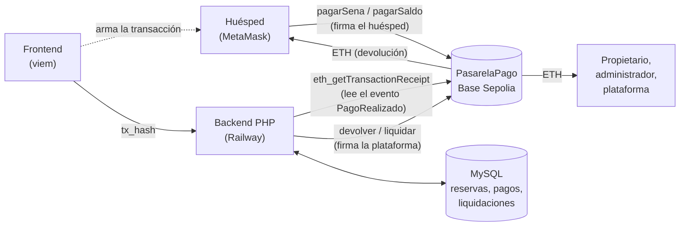
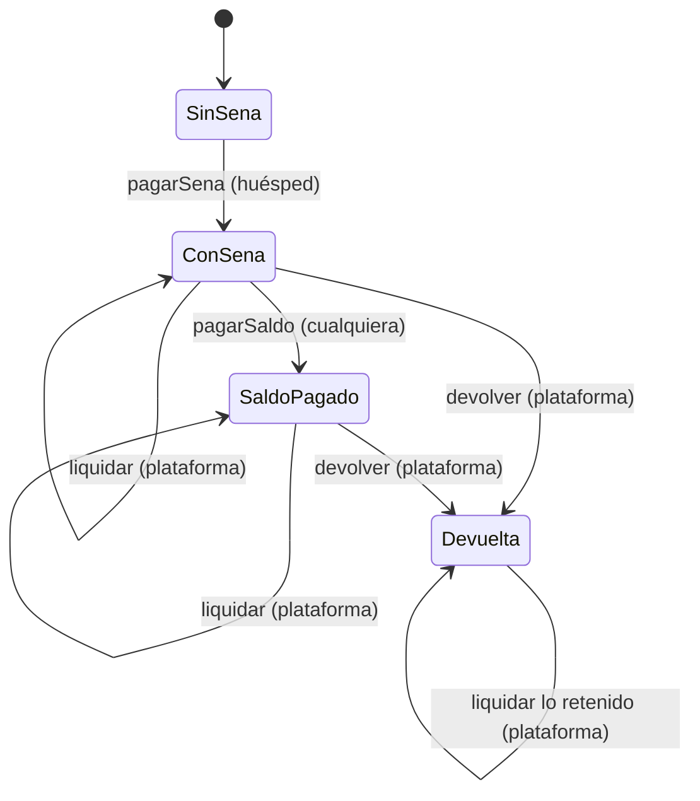
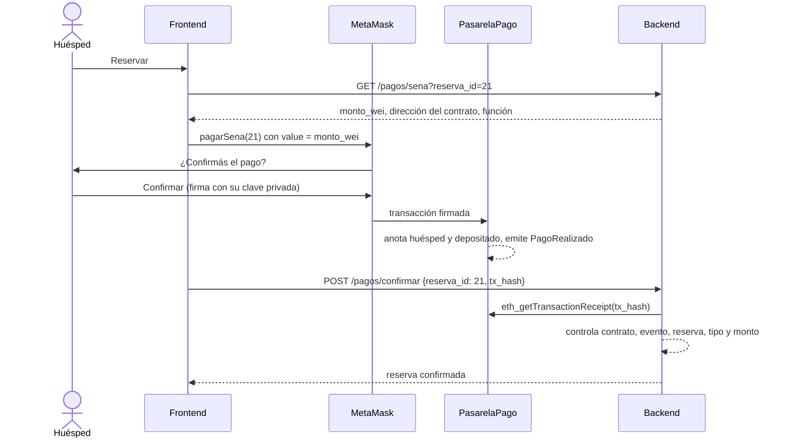

# PasarelaPago: diseño del contrato

Documentación del contrato inteligente que cobra las reservas de **HayLugar** (Alojamiento temporario, Seminario UNLu) en ETH de prueba. Cómo se probó y qué riesgos se cubrieron está en [`pruebas-y-seguridad.md`](pruebas-y-seguridad.md).

## 1. Qué problema resuelve

En HayLugar, un huésped reserva un alojamiento y paga en dos partes: una **seña** al reservar y el **saldo** unos días antes de ingresar. Si cancela, la política de la unidad define qué parte de la seña se retiene. Cuando ingresa, el dinero se reparte entre el **propietario**, el **administrador** (si la unidad tiene uno) y la **plataforma**.

El contrato reemplaza a una pasarela de pago tradicional (en el diseño original, Mercado Pago) y funciona como **escrow**: el dinero del huésped no va directo al propietario, sino que **queda retenido en el contrato** hasta que el huésped ingresa o cancela. Así se puede devolver lo que corresponde sin depender de que el propietario lo reintegre.

## 2. Arquitectura



| Pieza | Responsabilidad |
|---|---|
| **Contrato** (`src/PasarelaPago.sol`) | Recibe el ETH, lo retiene por reserva, emite eventos y garantiza las reglas de seguridad del dinero |
| **Frontend** | Conecta MetaMask, arma la transacción de pago con el monto en wei que le da el back y le pasa al back el `tx_hash` |
| **Backend** | Calcula los montos (precios en pesos, tipo de cambio, política de cancelación, comisiones), verifica cada pago leyendo el evento y firma `devolver` y `liquidar` con la billetera de la plataforma |
| **Base de datos** | Las reservas, los pagos con su `tx_hash` y las liquidaciones |

**División de responsabilidades.** El contrato **no conoce los precios ni la política de cancelación**: están en pesos en la base de datos y cambian con cada unidad y temporada. Ponerlos en la cadena obligaría a mantener dos copias sincronizadas y a pagar gas por cada cambio de precio. En cambio, el contrato se ocupa de lo que una base de datos no puede garantizar por sí sola: que el dinero **solo se mueva según reglas fijas que nadie puede cambiar**, ni siquiera la plataforma.

### Red y moneda

- **Red:** Base Sepolia (chain id 84532), la red de prueba de Base, una *layer 2* de Ethereum. Las transacciones se confirman en unos 2 segundos y el gas cuesta fracciones de centavo.
- **Moneda:** ETH de prueba, sin valor real. Los precios están en pesos; el back los convierte con un **tipo de cambio fijo** (parámetro `pesos_por_eth` = 100.000.000, elegido lejos del real para que el ETH de los faucets alcance para muchas pruebas). 1 ETH = 10¹⁸ wei, y todos los montos del contrato están en **wei**.

## 3. Estado que guarda

Por cada reserva, con el mismo id que tiene en la base de datos:

```solidity
struct Reserva {
    address huesped;      // la billetera que pagó la seña: la única a la que se le puede devolver
    uint256 depositado;   // todo el ETH que entró (seña + saldo), en wei
    uint256 liberado;     // todo el ETH que ya salió (devuelto + liquidado), en wei
    bool saldoPagado;     // el saldo se paga una sola vez
    bool devuelta;        // la devolución se hace una sola vez
}
mapping(uint256 reservaId => Reserva) public reservas;
```

La regla central es **`liberado ≤ depositado`**, controlada **por reserva**: lo que se puede sacar de una reserva (`disponible`) es `depositado − liberado`, y una reserva nunca puede usar el ETH de otra, aunque el contrato tenga más saldo en total.

### Ciclo de vida de una reserva en el contrato



`liquidar` no cambia de estado: se puede llamar mientras quede `disponible`. Después de `devolver`, la reserva no acepta más pagos.

## 4. Funciones

| Función | Quién | Qué controla | Evento |
|---|---|---|---|
| `pagarSena(reservaId)` *payable* | Cualquier billetera (el huésped) | Que venga ETH y que la reserva no tenga seña. Anota al huésped | `PagoRealizado(…, tipo = 0)` |
| `pagarSaldo(reservaId)` *payable* | Cualquier billetera | Que venga ETH, que haya seña, que no haya devolución y que el saldo no esté pago | `PagoRealizado(…, tipo = 1)` |
| `devolver(reservaId, huesped, monto)` | Solo la plataforma | Que haya seña, que no se haya devuelto antes, que `huesped` sea quien pagó la seña y que `monto ≤ disponible` | `Devolucion` |
| `liquidar(reservaId, destinatarios[], montos[])` | Solo la plataforma | Listas del mismo largo y no vacías, sin la dirección cero ni montos en cero, y que la suma sea `≤ disponible` | `Liquidacion` (una por destinatario) |
| `disponible(reservaId)` *view* | Cualquiera | — | — |
| `reservas(reservaId)` *view* | Cualquiera | — | — |
| `transferOwnership(nueva)` | Solo la plataforma | Heredada de OpenZeppelin `Ownable` | `OwnershipTransferred` |
| `renounceOwnership()` | — | Anulada: siempre revierte con `RenunciaNoPermitida` | — |

Los errores son *custom errors* con datos (por ejemplo, `FondosInsuficientes(reservaId, disponible, pedido)`): ocupan menos gas que un mensaje de texto y el back puede decodificarlos con el ABI.

## 5. Recorridos completos

### Pago de la seña



El back **no confía en el front**: con el `tx_hash` lee el recibo de la transacción en la red y controla que el evento lo haya emitido **la dirección de este contrato** (cualquiera podría desplegar otro contrato con un evento de igual nombre), que sea de la reserva y del tipo correctos, y que el monto coincida con el que calculó.

### Cancelación con devolución

1. El huésped cancela en la app. El back calcula la retención según la política de la unidad y los días que faltan (por ejemplo, el 30 % de la seña).
2. El back firma `devolver(reservaId, huesped, montoADevolver)` con la billetera de la plataforma.
3. El contrato controla que la billetera sea la que pagó la seña y que no se haya devuelto antes, anota y manda el ETH.
4. Lo retenido queda en el contrato y se le paga al propietario con `liquidar`.

### Liquidación al ingresar

1. El operador registra el ingreso del huésped en la app.
2. El back calcula el reparto (IVA, comisión de la plataforma y del administrador) y firma `liquidar(reservaId, [propietario, administrador, plataforma], [montos])`.
3. El contrato controla que la suma no supere lo disponible, emite un evento por destinatario y manda el ETH. Si un destinatario rechaza el ETH, se deshace **toda** la liquidación.

## 6. Decisiones de diseño

| # | Decisión | Por qué | Alternativa descartada |
|---|---|---|---|
| 1 | **Escrow**: el ETH queda en el contrato hasta el ingreso o la cancelación | Permite devolver sin depender del propietario y es lo que pide el negocio | Transferir directo al propietario al pagar: no habría forma de garantizar la devolución |
| 2 | El contrato **no conoce precios ni política** | Están en la base de datos, cambian seguido y dependen de cada unidad | Guardarlos en la cadena: dos copias que sincronizar y gas por cada cambio |
| 3 | Las reglas de seguridad del dinero **sí** están en el contrato | Valen aunque el back tenga un error o le roben la clave | Confiar solo en el back |
| 4 | `devolver` **una sola vez** por reserva | El back reintenta las devoluciones que fallan: si reintenta una que en realidad salió, el contrato la rechaza y el huésped no cobra dos veces | Permitir varias devoluciones |
| 5 | `liquidar` **varias veces**, con tope en lo disponible | Hay que poder liquidar lo retenido después de una devolución, o un saldo que se pagó tarde | Una sola liquidación por reserva |
| 6 | El saldo lo puede pagar **cualquier billetera** | El huésped puede pagar desde otra cuenta; las devoluciones siguen yendo a quien pagó la seña | Exigir la misma billetera |
| 7 | **Rechazar ETH suelto** (sin `receive` ni `fallback`) | Un ETH que no pasa por `pagarSena` o `pagarSaldo` no queda asociado a ninguna reserva | Aceptarlo y dejarlo sin dueño |
| 8 | `renounceOwnership` **anulada** | Sin dueña, nadie podría devolver ni liquidar y el ETH quedaría trabado para siempre | Dejar la de OpenZeppelin |
| 9 | Enviar con `call{value: …}` y revertir si falla | `transfer` limita el gas a 2300 y falla con billeteras inteligentes | `transfer` o `send` |
| 10 | Liquidación **todo o nada** | Nadie cobra a medias; la plataforma puede repetirla sin el destinatario que falló | Patrón *pull* (cada uno retira lo suyo): más seguro ante destinatarios maliciosos, pero obliga a propietarios y administradores a firmar un retiro |
| 11 | **Sin proxy** (no actualizable) | Más simple y sin los riesgos de un proxy; en una red de prueba, redesplegar cuesta casi nada | Patrón *upgradeable* de OpenZeppelin |
| 12 | Una sola billetera dueña (`Ownable`) | Alcanza para un proyecto académico | Multisig o `AccessControl` con roles separados (ver mejoras) |

## 7. Costos

Medidos con `forge test --gas-report` y en el despliegue real (precio del gas en Base Sepolia al desplegar: 0,006 gwei).

| Operación | Gas (mediana) | Costo aproximado en Base Sepolia |
|---|---|---|
| Despliegue | 1.389.190 | 0,0000083 ETH (el real) |
| `pagarSena` | 68.771 | 0,0000004 ETH |
| `pagarSaldo` | 54.070 | 0,0000003 ETH |
| `devolver` | 74.464 | 0,0000004 ETH |
| `liquidar` (1 a 3 destinatarios) | 77.126 (máx. 144.282) | 0,0000005 a 0,0000009 ETH |

El gas de `pagarSena` y `pagarSaldo` lo paga el huésped; el de `devolver` y `liquidar`, la billetera de la plataforma.

## 8. Despliegue actual

| Dato | Valor |
|---|---|
| Red | Base Sepolia (84532) |
| Contrato | [`0xF9d86D0e7c3D2520103fD11e64174C9e6BcFc0F4`](https://sepolia.basescan.org/address/0xF9d86D0e7c3D2520103fD11e64174C9e6BcFc0F4) (código verificado en basescan, Blockscout y Sourcify) |
| Dueña | [`0x734779432891a4E2C9152FdF6eCFFC34825b36B4`](https://sepolia.basescan.org/address/0x734779432891a4E2C9152FdF6eCFFC34825b36B4) |
| Compilador | Solidity 0.8.30, OpenZeppelin Contracts 5.7.0 |

Los pasos para desplegarlo están en el [README](../README.md#despliegue).

## 9. Limitaciones y mejoras posibles

- **Una sola clave controla las salidas.** Si se filtra la clave de la plataforma, el atacante puede liquidar el ETH disponible de cada reserva hacia su propia billetera (no puede devolverlo a otra billetera ni sacar más de lo depositado). En producción convendría una **multisig** o separar roles con `AccessControl` (uno para devolver, otro para liquidar) y un límite por operación.
- **El contrato no controla el monto de los pagos.** Un huésped podría pagar menos de lo que corresponde; el back lo detecta al verificar y no confirma la reserva, pero ese ETH queda en el contrato hasta que la plataforma lo devuelva. Una mejora sería que el back firme un "precio autorizado" por reserva y el contrato lo controle.
- **No es actualizable.** Un cambio de reglas implica desplegar otra versión y migrar a la nueva dirección.
- **Tests de invariantes.** Hoy la propiedad `liberado ≤ depositado` se prueba con *fuzz* sobre secuencias fijas; un test de invariantes de Foundry (secuencias de llamadas al azar) la reforzaría.
